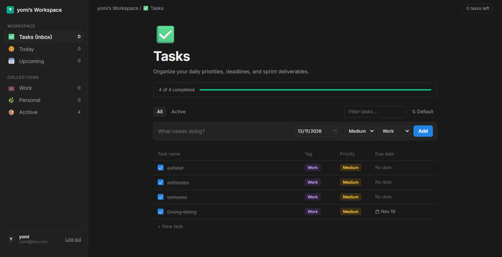
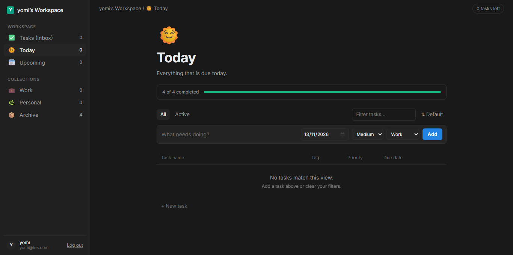
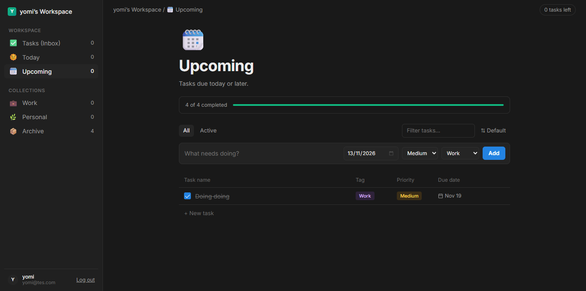
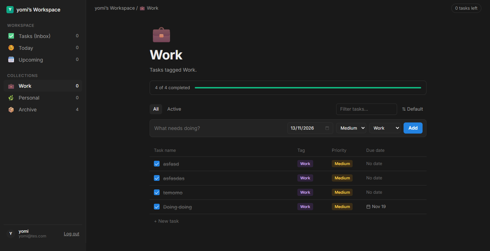
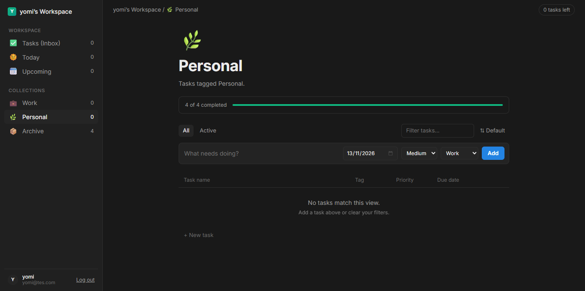
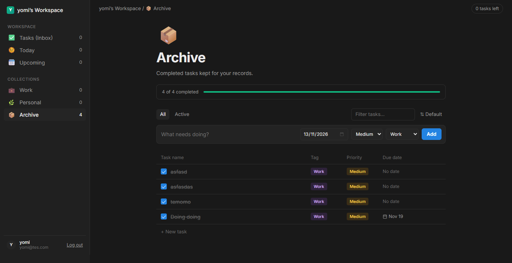
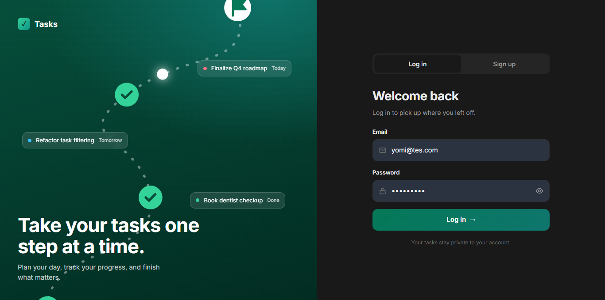
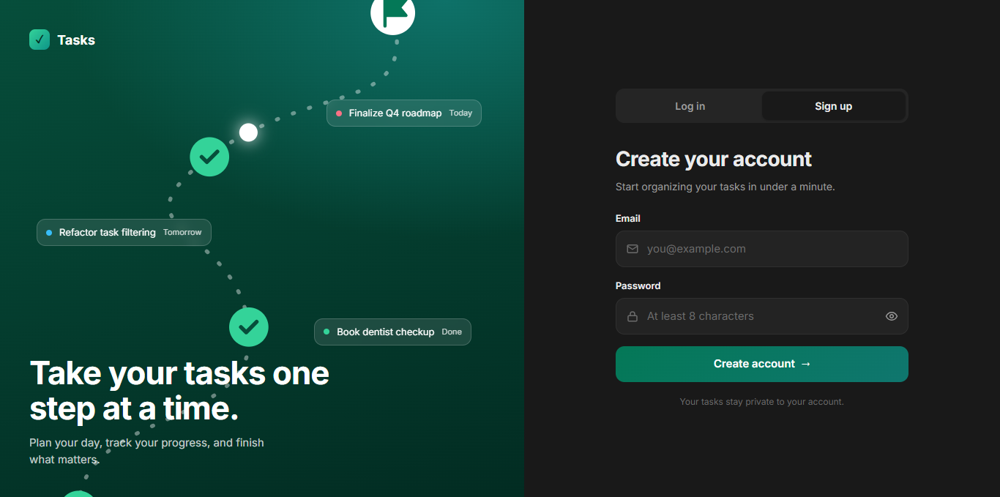

# Task Manager

A full-stack task manager with a Notion-style interface, user accounts, and a PostgreSQL database.


<!-- Replace with your own screenshot: save it as docs/screenshot.png -->


## Features

- **Accounts:** sign up and log in. Each user only sees and edits their own tasks.
- **Tasks with details:** title, due date, priority (Low, Medium, High), and tag (Work, Dev, Design, Personal).
- **Workspace views:** Inbox, Today, and Upcoming, plus Work, Personal, and Archive collections with live counts.
- **Productivity tools:** progress bar, All/Active tabs, text filter, and sorting by priority or due date.
- **Notion-style UI:** dark theme by default, light theme when your system prefers it, responsive layout.
- **Accessible:** keyboard navigation, labelled controls, visible focus states.

## Screenshots

| Today | Upcoming |
|---|---|
|  |  |

| Work | Personal | Archive |
|---|---|---|
|  |  |  |

| Log in | Sign up |
|---|---|
|  |  |

## Tech stack

| Layer | Technology |
|---|---|
| Frontend | React 18, Vite, plain CSS |
| Backend | Node.js, Express REST API |
| Database | PostgreSQL with Prisma ORM and migrations |
| Auth | JWT sessions, bcrypt password hashing |

## Getting started

**Requirements:** Node.js 18 or newer, and PostgreSQL (Docker is the quickest way).

**1. Start the database**
```
docker compose up -d
```
No Docker? Install PostgreSQL locally and use its connection string in the next step.

**2. Start the API**
```
cd server
cp .env.example .env
```
Open `server/.env` and set `JWT_SECRET` to a long random string. You can generate one with:
```
node -e "console.log(require('crypto').randomBytes(32).toString('hex'))"
```
Then:
```
npm install
npx prisma migrate dev
npm run dev
```
The API runs on http://localhost:4000. On Windows, use `copy` instead of `cp`.

**3. Start the frontend** (new terminal)
```
cd client
npm install
npm run dev
```
Open http://localhost:5173 and create an account.

## API

Protected routes expect the header `Authorization: Bearer <token>`.

| Method | Route | Auth | Description |
|---|---|---|---|
| POST | `/api/auth/register` | No | Create an account (`email`, `password`) |
| POST | `/api/auth/login` | No | Log in and receive a token |
| GET | `/api/auth/me` | Yes | Current user |
| GET | `/api/tasks` | Yes | List your tasks |
| POST | `/api/tasks` | Yes | Create a task (`title`, optional `dueDate`, `priority`, `tag`) |
| PATCH | `/api/tasks/:id` | Yes | Update `done`, `title`, `dueDate`, `priority`, or `tag` |
| DELETE | `/api/tasks/:id` | Yes | Delete one task |
| DELETE | `/api/tasks/completed` | Yes | Delete all completed tasks |
| GET | `/api/health` | No | Health check |

## Project structure

```
server/
  prisma/schema.prisma    data models (User, Task) and enums
  src/index.js            Express API: auth and task routes
client/
  src/App.jsx             login state and screen switching
  src/AuthForm.jsx        login and sign-up form
  src/Tasks.jsx           workspace UI: views, filters, table
  src/Sidebar.jsx         navigation and account
  src/api.js              API calls and token handling
```

## Security notes

- Passwords are stored as bcrypt hashes, never in plain text.
- Every task query is filtered by the logged-in user's id, so users cannot access each other's tasks.
- Inputs are validated on the server: titles, dates, priorities, tags, emails, and passwords.
- The token is kept in `localStorage` for simplicity. A production app should prefer an httpOnly cookie.

## Roadmap

- [ ] Board view with drag and drop
- [ ] Edit tasks in a side panel
- [ ] Automated API tests
- [ ] Rate limiting on login
- [ ] Live demo deployment